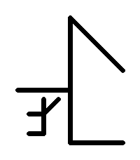

# Cistercian Time & Date

A Pebble watchface written in C using the Pebble SDK.

displays the time & date using [Cistercian numerals](https://en.wikipedia.org/wiki/Cistercian_numerals)



## Building & running

```sh
pebble build                          # build for target platform
pebble install --emulator emery       # install on the emery emulator
pebble install --cloudpebble          # install to watch using the Pebble Cloud
```

## Target platforms

tested only on the `emery` platform (Pebble Time 2), but it might work well with other platforms.
